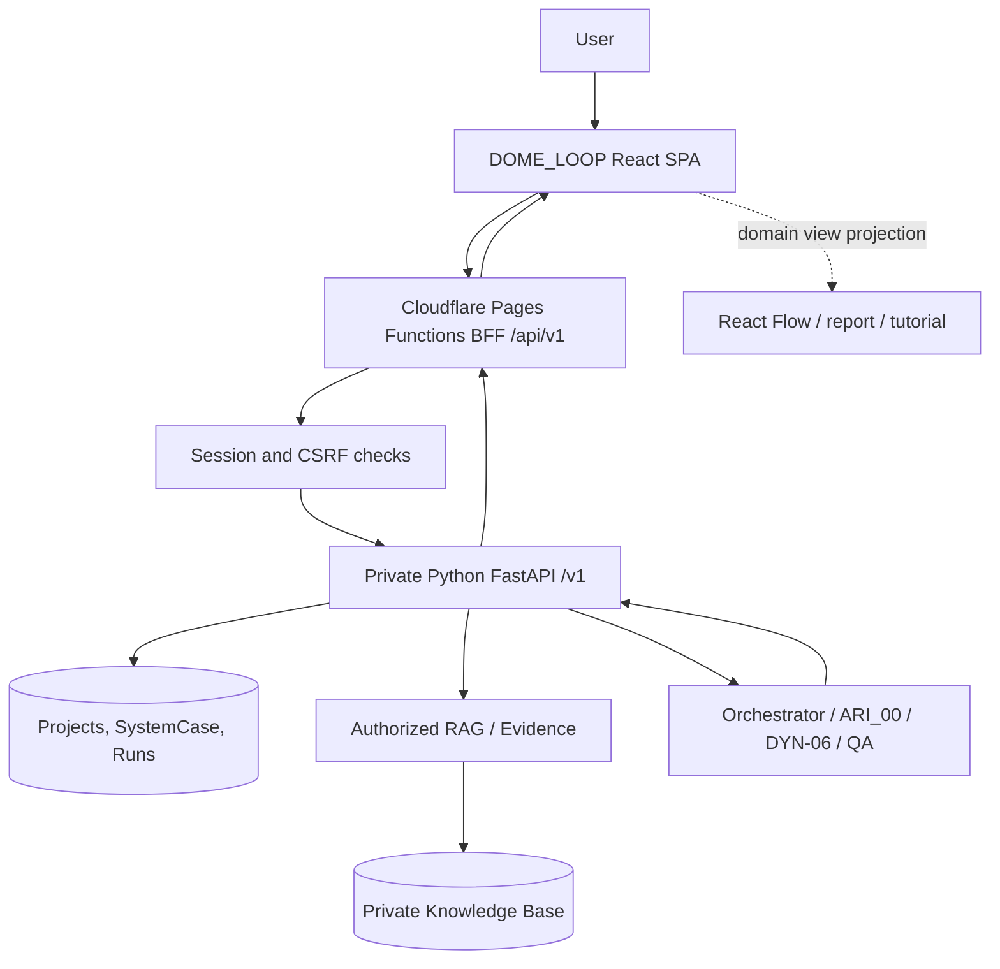

# LOOP Dynamics — Frontend Architecture, UI/UX Requirements and FRD

**Document ID:** LOOP-FE-001  
**Version:** 1.0 · 19 November 2026  
**Status:** Proposed target specification; not a claim of implemented functionality  
**Frontend:** `LOOPAPPdev/DOME_LOOP`, branch `MANUS`  
**Backend:** `LOOPAPPdev/loop-agentic-rag`, branch `feat/manus-agent-source-import`  
**Owner for implementation:** Manus / LOOP engineering

## 1. Evidence from current repositories

- `DOME_LOOP/frontend/src/App.tsx` imports static fixture `analysis` from `frontend/src/data/analysis.ts`. Its EvidenceRail, CausalCanvas and AnalysisRail render this fixture and do not yet invoke the private Python backend.
- `DOME_LOOP/frontend/src/components/` contains AppHeader, EvidenceRail, CausalCanvas, AnalysisRail and StatusStrip.
- `DOME_LOOP/docs/DESIGN_SYSTEM.md` defines light Kumo/Cloudflare design, IBM Plex Sans/Mono, blue for supported evidence, amber for hypotheses; CSS variables are in `frontend/src/styles/global.css`.
- The public DOME repo includes `functions/api/private-files/[[key]].ts` for a private R2 read flow, not an agent runtime. It is not called from the current React application.
- The private backend exposes `/health`, `/documents`, `/search`, and protected `/analyze/logic` on the reviewed feature branch. It does not yet expose the investigation service contract proposed below.
- `DOME_LOOP/src/loop_rag/langgraph_workflow.py` is deterministic and explicitly has no automatic LLM calls. It is *not* the same operational service as the private FastAPI project.

## 2. Decision and scope

**Decision:** Keep two repositories. `DOME_LOOP` owns the public-facing React app, design tokens, interaction logic and optional Cloudflare Pages BFF. `loop-agentic-rag` owns authentication/authorization enforcement, private knowledge, agent orchestration, scientific validation, jobs and persistence.

**Core principle:** A versioned `SystemCase` is the unique source of truth for domain edits. React Flow coordinates/selection are presentation state. App mode edits through authenticated API. Infographic and Tutorial modes read the same saved model, never maintain independent mutable copies.

**MVP user outcome:** An authorized user creates a project and a system, submits a question, inspects evidence and hypotheses, edits a causal graph, runs logic checks, and exports an evidence-backed report. Numerical simulation and external-world intervention require independent validation/approval; they are not available by default.

## 3. Topology and trust boundaries



**MUST:** never expose LLM keys, private tokens, R2 bucket credentials, local filesystem paths or a complete restricted knowledge base to the browser. BFF must verify the session and authorize the operation; the backend must independently enforce access to all retrieved records and actions. Frontend filtering is not a security boundary. The existing R2 endpoint is not a substitute for authentication/authorization or a full API.

**MUST:** preserve `tenant_id`, `project_id`, `system_id`, `run_id`, `schema_version` and source/evidence identifiers across all layers; avoid exposing unauthorized metadata.

## 4. Application routes (target)

| Route | Purpose | Access | Priority |
|---|---|---|---|
| `/` | Home / recent projects / create | authenticated | P0 |
| `/projects` | project list and search | authenticated | P0 |
| `/projects/:projectId/systems/:systemId/app` | canonical system editor | editor | P0 |
| `/projects/:projectId/systems/:systemId/infographic` | derived read-only report | viewer | P1 |
| `/projects/:projectId/systems/:systemId/tutorial` | derived read-only walkthrough | viewer | P1 |
| `/projects/:projectId/runs/:runId` | progress / trace / audit | viewer | P0 |
| `/knowledge` | authorized sources and provenance | viewer | P1 |
| `/settings` | preferences / accessibility / profile | authenticated | P1 |

A single canonical URL identifies each entity. Direct reload, back/forward, deep links, 404 and 403 must work. Route titles and breadcrumbs derive from current project/system.

## 5. Information architecture / navigation

**Desktop:** global top bar (brand, project, history, save/run state, account), compact collapsible left nav (Home, Projects, Systems, Knowledge, Runs, Settings), central workspace, contextual inspector to the right. The canvas is the dominant region. A bottom composer submits system instructions and can show validation and run progress. Panels may be resized/hidden.

**Tablet:** collapsible sidebar, main canvas, inspector as a drawer, bottom composer. Breakpoint design target approximately 860 CSS px; choose content-based breakpoints after testing, not arbitrary device names.

**Mobile 320–860 CSS px:** one dominant content region; primary navigation collapses into menu; canvas gets available width and pan/zoom controls; inspector and sources open as tabs/drawers. Use readable list view of nodes/edges as a keyboard/screen-reader alternative. Keep Run, Save and Evidence actions accessible. No horizontal scrolling of ordinary text/page content; horizontal movement inside the graph is permitted with an equivalent linear representation.

## 6. Canonical UI modes and data responsibilities

| Mode | Data access | Editable? | Main components |
|---|---|---|---|
| App | load/save `SystemCase`, read `EvidenceBundle`, read runs | yes, RBAC | graph canvas, inspector, evidence rail, composer |
| Infographic | projection of versioned `SystemCase` + approved analysis | no | print/export layout, causal map, supported claims, confidence/limits |
| Tutorial | projection of same `SystemCase` + methodology steps | no | stepper, definitions, annotated edges, examples, checks |

**MUST:** changing a SystemCase in App updates the other modes on reload/refetch. **MUST NOT:** write source-of-truth data directly from Infographic or Tutorial.

## 7. Frontend modules / target folder boundaries

```text
DOME_LOOP/
├── frontend/
│   ├── src/
│   │   ├── app/                 # bootstrap, routes, providers, error boundaries
│   │   ├── routes/              # home, projects, system app/infographic/tutorial, runs
│   │   ├── features/
│   │   │   ├── projects/         # project lifecycle
│   │   │   ├── systems/          # SystemCase editor, versioning
│   │   │   ├── canvas/           # React Flow rendering, selection, viewport
│   │   │   ├── evidence/         # citations, source viewer, provenance
│   │   │   ├── investigations/   # input, run status, trace
│   │   │   ├── logic/            # ARI_00 reports
│   │   │   ├── reports/          # derived infographic/tutorial/export
│   │   │   └── settings/         # UI preferences
│   │   ├── shared/
│   │   │   ├── api/              # typed authenticated HTTP client; error mapping
│   │   │   ├── contracts/        # generated/validated DTOs from OpenAPI/JSON Schema
│   │   │   ├── components/       # accessible layout, buttons, dialogs, status
│   │   │   ├── hooks/            # network state, safe transitions
│   │   │   └── styles/           # existing LOOP design tokens
│   │   └── tests/
│   ├── public/                  # safe static assets only
│   └── package.json
├── functions/
│   └── api/v1/                 # authenticated proxy/BFF, no LLM logic
└── docs/
    └── FRONTEND_SPEC.md
```

**Do not** copy `agents/`, LLM runtime or SQLite into public frontend. Keep domain models and public DTOs decoupled. Use typed API responses and schema validation. Keep React Flow node positions as UI metadata, separate from physical/causal semantics.

## 8. Functional requirements (EARS / RFC 2119)

| ID | Requirement | Priority | Acceptance observation |
|---|---|---|---|
| FE-001 | WHEN the user opens the app, THEN show authenticated session and accessible project navigation. | P0 | loading, signed-out, error, ready all render |
| FE-002 | WHEN creating a project/system, THEN persist immutable IDs and a first version. | P0 | reload preserves saved data |
| FE-003 | WHEN the user selects a node/edge, THEN Inspector MUST show type, units, polarity, delay, evidence and validation state. | P0 | inspected entity matches ID |
| FE-004 | WHEN the user edits domain fields in App, THEN validate client side for usability and server side for authority; save a version with conflict protection. | P0 | two-tab edit conflict is handled |
| FE-005 | WHEN a question is submitted, THEN show a `run_id`, status and bounded progress, with cancel/retry or safe retry. | P0 | visible terminal state; no fake spinner |
| FE-006 | WHEN evidence is shown, THEN expose source ID, document, location/page, access-safe excerpt and linked claims. | P0 | each cited claim has verifiable pointer |
| FE-007 | IF evidence is insufficient, THEN present `unverified`/`insufficient_evidence` and missing inputs; MUST NOT show fabricated citations. | P0 | no evidence -> no 'verified' UI |
| FE-008 | WHEN a causal link is displayed, THEN distinguish `hypothesis`, `supported`, `contradicted`, `unverified`; include polarity `+/-/unknown` and delay. | P0 | labels and patterns independent of color |
| FE-009 | WHEN ARI_00 returns a report, THEN show formal validity separately from premise truth and soundness, and show counterexample/limits. | P0 | valid but unsupported premises not shown 'sound' |
| FE-010 | IF the simulation contract is incomplete, THEN disable Simulate and show missing equations/units/parameters/initial conditions. | P0 | no numerical result without gate |
| FE-011 | WHEN opening Infographic or Tutorial, THEN render read-only projections from same SystemCase revision. | P1 | read-only mode cannot mutate backend |
| FE-012 | WHEN exporting, THEN include version, source provenance, limitations and timestamp; exclude unauthorized source text. | P1 | download metadata and access checks |
| FE-013 | WHEN an API request returns 401/403/409/422/429/5xx, THEN show specific recovery and preserve unsent user input. | P0 | no silent failure |
| FE-014 | WHEN run state changes, THEN display queued/running/awaiting_review/complete/failed/cancelled with accessible updates. | P0 | status derived from server, not timer |
| FE-015 | WHEN users navigate by keyboard or screen reader, THEN all primary tasks remain possible including a linear graph alternative. | P0 | accessibility audit passes |
| FE-016 | WHEN a decision/action changes an external system, THEN require explicit confirmed approval; no implicit side effects. | P0 | denial path produces zero writes |
| FE-017 | WHEN the app is in demo mode, THEN label every example as fictitious and never show a fake live status. | P0 | demo cannot be mistaken for production data |
| FE-018 | WHEN access rights or source versions change, THEN re-authorize fetches and invalidate stale private caches. | P0 | revoke access prevents subsequent reads |

## 9. Design system and accessibility

Reuse existing `DOME_LOOP/docs/DESIGN_SYSTEM.md` and `frontend/src/styles/global.css`:
- Canvas: `#FAFAFA`; surfaces `#FFFFFF`; primary text `#171717`; border `#E5E5E5`.
- Action/verified evidence accent: `#046CFE`; hypothesis accent: amber. These are semantic color roles, not substitutes for labels.
- Typography: IBM Plex Sans for UI; IBM Plex Mono for IDs and technical metadata. Do not load hidden proprietary fonts. Add system fallbacks.
- Responsive: mobile first; content-driven breakpoints; collapsible navigation and inspector.
- Design primitives: buttons, input/composer, source cards, node/edge, statuses, inspector sections, drawers, dialogs, stepper, tabs, toast/alert, skeleton, empty/permission/failed/offline screens.
- Reuse existing design tokens; create only missing semantic tokens (`--loop-hypothesis`, `--loop-verified`, `--loop-focus`, etc.).
- WCAG 2.2 AA target. At 320 CSS px, content reflows; graph has an accessible linear alternative. Interactive targets minimum WCAG 24x24 CSS px or approved spacing exceptions; UI target **44x44 CSS px** for touch where feasible. Support keyboard, visible focus, screen readers, reduced motion, browser zoom and sufficient contrast.
- Prefer progressive disclosure: show only problem, canvas, evidence state and next action initially; reveal advanced properties in Inspector. Avoid overloading the viewport with all agent traces and numerical metadata.
- Preserve focus/selection after overlays close. Use accessible status announcements for running/completed/failed.
- Avoid unexplained single numerical confidence badges; convey sources, review type and limitations for each claim.

References: https://www.w3.org/TR/WCAG22/ ; https://reactflow.dev/learn/advanced-use/accessibility

## 10. API and state contracts (proposed; MUST be agreed with backend first)

### Endpoints

- `GET /api/v1/me` — identity and capabilities, server-derived.
- `GET/POST /api/v1/projects` — list/create.
- `GET/POST /api/v1/projects/{projectId}/systems` — list/create.
- `GET /api/v1/systems/{systemId}` — versioned `SystemCase`.
- `PATCH /api/v1/systems/{systemId}` — JSON patch/diff with `If-Match`/revision; server validation.
- `POST /api/v1/investigations` — submit `{project_id,system_id,question}` -> `{run_id,status}`.
- `GET /api/v1/investigations/{runId}` — progress, artifact pointers and result.
- `POST /api/v1/investigations/{runId}/cancel` — cancel; idempotent.
- `GET /api/v1/evidence/{evidenceId}` — access-checked evidence details.
- `POST /api/v1/logic/validate` — ARI_00 adapter (not equivalent to current `/analyze/logic` until mapped).
- `GET /api/v1/systems/{systemId}/report?mode=infographic|tutorial` — read-only projection.
- `POST /api/v1/systems/{systemId}/simulation/validate` — gate check only; simulation engine later.

**Status:** all `/api/v1/*` contracts above are target interfaces and are NOT currently implemented in DOME_LOOP or the private API as described. The current private API includes `/health`, `/documents`, `/search`, `/analyze/logic`; `/documents` and `/search` require additional authorization before exposure.

### Domain object boundary

```ts
interface SystemCase {
  id: string;
  projectId: string;
  revision: string;
  title: string;
  problem: string;
  scope: string;
  variables: Array<{ id: string; name: string; kind: 'stock' | 'flow' | 'auxiliary' | 'unknown'; unit?: string }>;
  relations: Array<{ id: string; sourceId: string; targetId: string; polarity: '+' | '-' | 'unknown'; delay: boolean | 'unknown'; status: 'hypothesis' | 'supported' | 'contradicted' | 'unverified'; evidenceIds: string[] }>;
  evidenceIds: string[];
  simulation: { status: 'not_performed' | 'blocked' | 'validated'; missingRequirements?: string[] };
}
```

This is a TypeScript design example, **not** a published production schema. Align field naming and enums with canonical JSON Schemas in private backend; use generation/validation rather than manual duplication. `supported` means evidence support has been assessed, not simply that a citation exists.

### Runtime states

`draft → queued → planning → retrieving → modelling → validating → completed` with exceptional `awaiting_review`, `insufficient_evidence`, `failed`, `cancelled`, `budget_exceeded`, `unauthorized`. Server is source of truth for transitions and timestamps. Poll initially; use SSE only after authorization, reconnection and resumption semantics are tested. Avoid invented progress percentages.

### Client data-management rules

- Server state: use TanStack Query or equivalent request cache with explicit query keys, retries, invalidation and access-aware cache clearing.
- UI state: React local state/context for panel visibility, graph selection, viewport and drafts; do not put credentials in localStorage.
- Domain version state: server controls revisions and approvals; optimistic editing MUST handle conflicts.
- Rendering state is not analytical truth. React Flow coordinates and zoom cannot alter actual causal evidence.

## 11. Verification plan

### Unit/component
- Node and edge click selects correct Inspector entity; evidence cross-highlights all supported claims and relations.
- Required field validation; keyboard navigation; empty/error/unauthorized states.
- Infographic and Tutorial cannot invoke edit mutation.
- Status strip uses backend state; fixture mode is explicitly labelled DEMO.

### Contract
- OpenAPI/JSON Schema validated for request and response; unknown status/schema versions rejected gracefully.
- Auth, tenant isolation, expired session, permission-denied evidence, 409 version conflict.
- Semantic statuses map without false promotion (`retrieved != verified`, `hypothesis != fact`, `valid != sound`).

### E2E (Playwright, browser)
1. GIVEN authenticated editor, WHEN creating and reloading a system, THEN content and version persist.
2. GIVEN a question, WHEN submitting, THEN run ID and real status appear; result citations are linked to accessible source locators.
3. GIVEN invalid logical inference, WHEN ARI_00 returns `INVALID`, THEN counterexample shown and claim not promoted to verified.
4. GIVEN withheld evidence, WHEN viewer requests source, THEN response is 403 and no private data leak.
5. GIVEN no equations/units, WHEN Simulate requested, THEN show blocked gate and no numeric output.
6. GIVEN narrow viewport and keyboard-only user, WHEN selecting a variable, THEN equivalent details are accessible without canvas drag.
7. GIVEN network interruption, WHEN fetch fails, THEN user input persists and appropriate retry is offered.
8. GIVEN demo build, WHEN displaying analysis, THEN all fixture-derived results labelled as demo, not a real live run.

### Quality gates
- Q0: no forbidden secrets/private PDFs/indexes in public `frontend/dist` or source.
- Q1: TypeScript strict build + components/units.
- Q2: WCAG 2.2 AA manual and automated verification, including graph alternative and 320px reflow.
- Q3: API contracts, identity and permission checks including cross-tenant failure cases.
- Q4: integration between DOME Pages BFF and private FastAPI staging, with trace IDs and real run states.
- Q5: E2E CI green on staging and evidence references independently checked.

## 12. Delivery order

**Iteration A / UX baseline:** routing, navigation, reusable design tokens, `SystemCase` display, inspector, evidence selection, demo mode clearly indicated; component/keyboard tests.

**Iteration B / service integration:** secure BFF, generated contracts, signed-in state, new project/system, run status, evidence viewer, handling 401/403/409/5xx, real API connection to ARI_00 and RAG/analysis; contract/E2E tests.

**Iteration C / scientific product:** causal graph editing, versioning, hypotheses and confidence/provenance review, infographic/tutorial read-only projection, human approval gates, reports/export; performance/accessibility/security audit.

**Out of scope until approved:** actual numerical simulation, actions affecting other companies/systems, automated claims of source verification without independent evaluation, offline publication of full copyright-protected books.

**Definition of done:** the authenticated user creates a system, submits a question, receives a real analysis with a traceable `run_id`, inspects authorized evidence, edits a versioned causal model, reviews ARI_00/QA status, and sees the same revision in App, Infographic and Tutorial. CI and staging E2E pass. The app never shows fictional data as production outcomes.

## 13. Key repository source files

- `DOME_LOOP/frontend/src/App.tsx`
- `DOME_LOOP/frontend/src/data/analysis.ts`
- `DOME_LOOP/frontend/src/components/{AppHeader,CausalCanvas,EvidenceRail,AnalysisRail,StatusStrip}.tsx`
- `DOME_LOOP/frontend/src/styles/global.css`
- `DOME_LOOP/docs/{DESIGN_SYSTEM,FRONTEND}.md`
- `DOME_LOOP/functions/api/private-files/[[key]].ts`
- `loop-agentic-rag/src/loop_agentic_rag/api.py` on `feat/manus-agent-source-import`
- `loop-agentic-rag/schemas/analysis-response.schema.json`
- `loop-agentic-rag/docs/IMPLEMENTATION_PLAN.md`